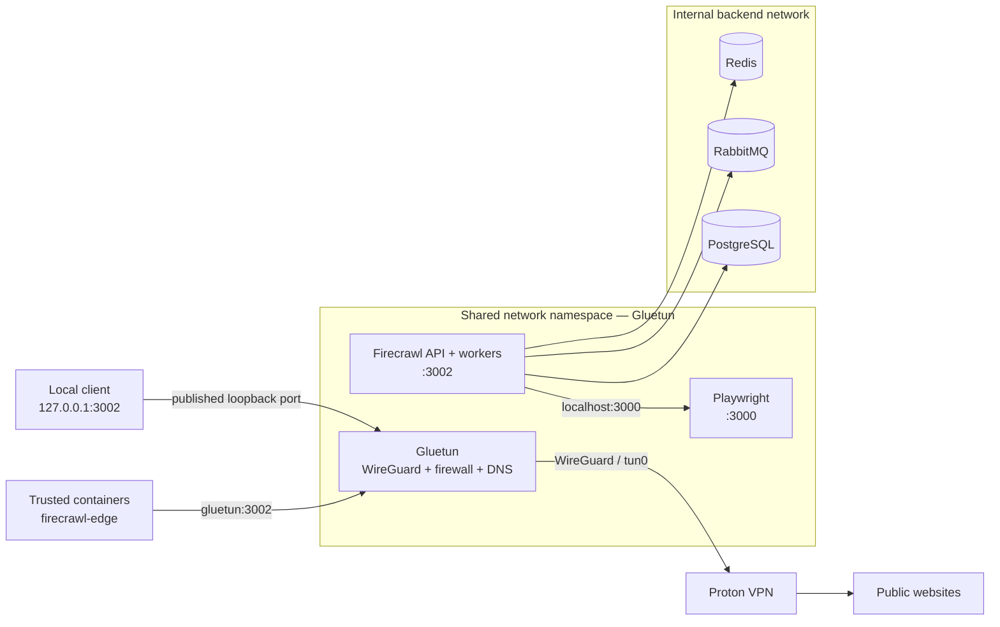

<div align="center">

# 🛡️ Firecrawl over Proton VPN

**Self-hosted Firecrawl traffic routed through Proton VPN with a fail-closed network design.**

[](https://github.com/beto-zip/web-scraping-firecrawl-vpn/actions/workflows/validate.yml)
[](LICENSE)


**English** · [Português (Brasil)](README.pt-BR.md)

[Overview](#overview) · [Architecture](#architecture) · [Quick start](#quick-start) · [Security](#security-and-limitations) · [Status](#project-status) · [Documentation](#documentation) · [Support](#support-the-project)

</div>

> [!IMPORTANT]
> **Deployment validation is still pending.** The code and test tools exist, but the complete stack has **not yet been verified on the target Linux/Tailscale/OpenClaw server** ([issue #6](https://github.com/beto-zip/web-scraping-firecrawl-vpn/issues/6)). Do not treat the VPN kill switch or leak protection as production-verified until you run the network tests on your own host.
>
> **Independent community project.** Not affiliated with Firecrawl, Proton VPN or Gluetun.

## Overview

Setting an HTTP proxy does not guarantee that every scraper, browser, DNS request or internal client uses it. This repository runs Firecrawl's API/workers and Playwright inside **Gluetun's shared Docker network namespace**. Gluetun provides the Proton VPN WireGuard tunnel and firewall; the scraping services have no separate external Docker network interface.

| Capability | Implementation |
|:--|:--|
| 🛡️ VPN-bound egress | Firecrawl and Playwright use `network_mode: service:gluetun`. |
| 🚫 Fail-closed design | Gluetun's firewall is configured to deny direct internet egress if the tunnel is unavailable; **real-host verification is pending**. |
| 🌍 Exit selection | Configure a Proton country/city and request reconnection with `scripts/rotate-ip.sh`. A new IP is **not guaranteed**. |
| 🔒 Isolated backend | Redis, RabbitMQ and PostgreSQL use a Docker network with `internal: true`. |
| 🔌 Local integration | Local API on `127.0.0.1:3002` and access for *trusted* containers via `firecrawl-edge`. |
| 🧪 Security checks | Scripts cover validation, egress, kill switch, rotation and recovery. CI alone cannot test a live VPN. |

## Architecture



**What matters:** the API and browser share Gluetun's network stack, while the databases stay on a separate internal-only network. This is a **network design**, not proof that every threat or leak has been eliminated. Details: [architecture](docs/architecture.md) and [security model](docs/security.md).

## Quick start

### Requirements

- Linux with Docker Engine, Docker Compose v2 and `/dev/net/tun`.
- A **paid Proton VPN plan** and a generated WireGuard configuration. See [Proton VPN setup](docs/protonvpn.md).
- `curl` to run the network checks; `openssl` to generate strong passwords.
- Adequate memory for browser workloads. The documented idle footprint is approximately 2.5 GB; actual usage varies with workload.

### Install

```bash
git clone https://github.com/beto-zip/web-scraping-firecrawl-vpn.git
cd web-scraping-firecrawl-vpn
cp .env.example .env

# Edit .env: paste the WireGuard PrivateKey and set the
# required passwords / control API key.
# Generate each secret separately with: openssl rand -hex 24
# NEVER commit .env or the Proton .conf file.

./scripts/validate.sh
docker compose up -d
docker compose ps
```

Keep `API_BIND_ADDRESS=127.0.0.1` in `.env`. **The Firecrawl API has no general authentication enabled**; do not expose port 3002 to the public internet.

### Request a scrape

```bash
curl -sS -X POST http://127.0.0.1:3002/v2/scrape \
  -H 'Content-Type: application/json' \
  -d '{"url":"https://example.com","formats":["markdown"]}'
```

A trusted app attached to `firecrawl-edge` can call `http://gluetun:3002`. See the [client example](examples/client/README.md).

For operating-system details, environment variables, updates and uninstall steps, use the [full installation guide](docs/installation.md).

## Security and limitations

The stack is configured to restrict how requests reach the internet, but it **has not undergone a complete security audit**.

- **Kill switch:** firewall rules are intended to block direct egress when the VPN is down; test this on the deployment host.
- **DNS and IPv6:** DNS is configured through Gluetun (DNS over TLS); Docker networks are IPv4-only.
- **Private destinations:** additional rules restrict connections to host/LAN/Tailscale and cloud metadata ranges, except the backend subnet needed by services.
- **API boundary:** any container trusted with access to `firecrawl-edge` can reach other ports in the shared namespace. Do not attach untrusted containers.
- **Restarts:** a tunnel reconnection is different from a Gluetun container restart. After restarting Gluetun, run `docker compose restart api playwright`; if Gluetun is *recreated*, use `docker compose up -d`.
- **IP rotation:** reconnection can reuse the same exit IP and interrupt in-flight requests.

### Validate the actual environment

```bash
# All tests except the recovery suite:
./scripts/run-tests.sh --skip-recovery

# Full test suite (also restarts containers):
./scripts/run-tests.sh
```

> [!WARNING]
> **Both commands can disrupt active scraping connections**, including with `--skip-recovery`. Run during a maintenance window. Reports go to `reports/` with secrets/IPs redacted; review them before sharing. CI checks are not substitutes for real VPN tests.

More information: [security controls and residual risks](docs/security.md) · [known limitations](docs/architecture.md#known-limitations) · [troubleshooting](docs/troubleshooting.md).

## Project status

| Workstream | Status |
|:--|:--|
| Docker stack, configuration validation, VPN namespace and test scripts | Implemented in the repository; real-server verification pending |
| Linux deployment with Tailscale and OpenClaw | [Open issue #6](https://github.com/beto-zip/web-scraping-firecrawl-vpn/issues/6) |
| Simpler Docker-only operations | [Planned #2](https://github.com/beto-zip/web-scraping-firecrawl-vpn/issues/2) |
| Retry/block detection and resilience | [Planned #3](https://github.com/beto-zip/web-scraping-firecrawl-vpn/issues/3) |
| Persistent job queue / resume | [Planned #4](https://github.com/beto-zip/web-scraping-firecrawl-vpn/issues/4) |
| Optional community donations | [Backlog #10](https://github.com/beto-zip/web-scraping-firecrawl-vpn/issues/10); not enabled |

Track current work in [GitHub Issues](https://github.com/beto-zip/web-scraping-firecrawl-vpn/issues). Planned features are **not included** in the current release.

## Documentation

| Guide | Contents |
|:--|:--|
| [Installation](docs/installation.md) | Setup, updates and removal |
| [Proton VPN](docs/protonvpn.md) | WireGuard key, exit region and rotation |
| [Architecture](docs/architecture.md) | Network isolation, components and ADRs |
| [Security](docs/security.md) | Threat model, safeguards and residual risks |
| [Troubleshooting](docs/troubleshooting.md) | Debugging and recovery |
| [Client example](examples/client/README.md) | Connect an external Docker application |

## Contributing

Use the [issue templates](.github/ISSUE_TEMPLATE) for bug reports and reproducible results. Focused pull requests and documentation fixes are welcome. **Never publish** `.env`, WireGuard private keys, unredacted IP addresses or sensitive logs. Respect the VPN provider's terms and target websites' terms and `robots.txt`; the project does not implement automated CAPTCHA solving.

## License

The original files in this repository are licensed under [MIT](LICENSE). Third-party container images remain subject to their own licenses (including Firecrawl's AGPL-3.0); those terms are not replaced by this repository's MIT license.

## Support the project (planned)

The project is free and open source. A **cryptocurrency-only donation page prototype** exists for Bitcoin, Monero and Ethereum, but **donations are not enabled**. The Bitcoin public receiving address has been added to the prototype; Monero and Ethereum are not yet configured.

- [View the donation page source](docs/donate/index.html) and [setup/status notes](docs/donate/README.md).
- **GitHub Pages publication is not verified.** A live donation page is not being advertised here.
- Fundraising will be considered only after [server validation #6](https://github.com/beto-zip/web-scraping-firecrawl-vpn/issues/6) and the [release/funding requirements in #10](https://github.com/beto-zip/web-scraping-firecrawl-vpn/issues/10).

Any future contribution would be **optional**, with no guaranteed support, feature priority, special access or security guarantees.
