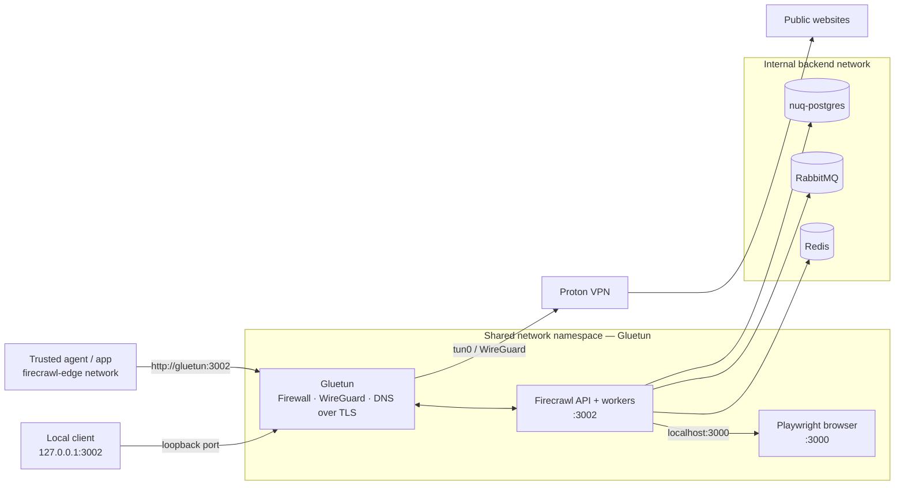

<div align="center">

# 🛡️ Firecrawl over Proton VPN

**Self-hosted web scraping with VPN-only outbound traffic and a fail-closed network boundary.**

[](https://github.com/beto-zip/web-scraping-firecrawl-vpn/actions/workflows/validate.yml)
[](LICENSE)


**English** · [Português (Brasil)](README.pt-BR.md)

[Why this project](#why-this-project) · [Architecture](#architecture) · [Quick start](#quick-start) · [Security](#security-boundaries) · [Roadmap](#roadmap) · [Support](#support-the-project)

</div>

> [!IMPORTANT]
> **Community project, not an official integration.** Not affiliated with [Firecrawl](https://github.com/firecrawl/firecrawl), [Proton VPN](https://protonvpn.com/) or [Gluetun](https://github.com/qdm12/gluetun). The deployment is **not yet validated on the target Linux server** ([tracking issue #6](https://github.com/beto-zip/web-scraping-firecrawl-vpn/issues/6)); run the network security tests before trusting it with sensitive workloads.

## Why this project?

Scraping tools can accidentally expose the host IP when only some HTTP requests use a proxy. This stack takes a different approach: **Firecrawl's API and Playwright share Gluetun's network namespace**, so outbound connections are governed by the same firewall and Proton VPN WireGuard tunnel.

| Capability | How it works |
|:--|:--|
| 🛡️ **Fail-closed egress** | The firewall blocks direct internet access when the VPN tunnel is unavailable. |
| 🌍 **Selectable VPN exit** | Set Proton exit country/city in `.env`; request a new IP with `scripts/rotate-ip.sh`. |
| 🧩 **Self-hosted Firecrawl** | Scrape/crawl API, workers and Playwright browser inside Docker Compose. |
| 🔒 **Private backend** | Redis, RabbitMQ and PostgreSQL stay on an internal Docker network. |
| 🔌 **Agent-friendly access** | Local API at `127.0.0.1:3002` or trusted containers on `firecrawl-edge`. |
| 🧪 **Network verification** | Scripts check VPN egress, the kill switch, IP rotation and service recovery. |

## Architecture



**The essential distinction:** `api` and `playwright` use `network_mode: service:gluetun`. They do **not** have independent outbound Docker network interfaces. Gluetun's firewall enforces the tunnel boundary; the `backend` network is `internal: true`, and the `edge` network is for trusted API consumers.

For implementation details, firewall rules and architecture decisions, see [Architecture](docs/architecture.md) and [Security](docs/security.md).

## Quick start

### Requirements

- Linux host with Docker Engine, Docker Compose v2 and `/dev/net/tun`.
- **Paid Proton VPN plan** with a generated WireGuard configuration; see [Proton setup](docs/protonvpn.md).
- `curl` for runtime tests, and `openssl` to generate secrets (`jq` optional).
- Enough RAM for browser workloads; see [installation requirements](docs/installation.md).

### Install and start

```bash
git clone https://github.com/beto-zip/web-scraping-firecrawl-vpn.git
cd web-scraping-firecrawl-vpn

cp .env.example .env
# Add the WireGuard PrivateKey and generate the required passwords:
# openssl rand -hex 24
# Never commit .env or the downloaded Proton .conf file.

./scripts/validate.sh
docker compose up -d
docker compose ps
```

Keep `API_BIND_ADDRESS=127.0.0.1` unless you have separately designed an authenticated access boundary: **the self-hosted API has no general authentication enabled**.

### Try a scrape

```bash
curl -sS -X POST http://127.0.0.1:3002/v2/scrape \
  -H 'Content-Type: application/json' \
  -d '{"url":"https://example.com","formats":["markdown"]}'
```

A trusted container connected to `firecrawl-edge` can call `http://gluetun:3002` instead. See the [client integration example](examples/client/README.md).

**Full instructions:** [Installation](docs/installation.md) · [WireGuard key and VPN locations](docs/protonvpn.md) · [Troubleshooting](docs/troubleshooting.md).

## Security boundaries

This project is built around **network isolation, not a proxy setting**:

1. **Tunnel down → no direct scraping egress.** Gluetun's firewall is designed to deny outbound traffic outside the tunnel.
2. **No IPv6 egress path.** The Docker networks are IPv4-only; DNS resolution is managed by Gluetun over TLS.
3. **Private destinations restricted.** Additional firewall rules block new connections toward LAN, Tailscale/CGNAT and cloud metadata ranges, except the required backend subnet.
4. **No raw-socket escape in scraping services.** Firecrawl and Playwright drop Linux capabilities.
5. **Host routing remains independent.** The stack's routing changes are scoped to its Docker namespace; **host/Tailscale coexistence still requires real-server verification** ([#6](https://github.com/beto-zip/web-scraping-firecrawl-vpn/issues/6)).

> [!WARNING]
> Do **not** expose port 3002 publicly or attach untrusted containers to `firecrawl-edge`. The API has no general auth layer, and edge members can reach other ports in the shared namespace. This is not a claim of a completed security audit.

### Validate on your own host

```bash
./scripts/run-tests.sh --skip-recovery
# Full suite (includes restarting containers):
./scripts/run-tests.sh
```

The suites cover `validate.sh`, scraping, VPN egress, kill switch, rotation and recovery. **Even `--skip-recovery` runs disruptive network tests**; use a maintenance window. Reports are written to `reports/` with IPs and secrets redacted. CI runs static/unit checks without real Proton credentials; CI alone cannot prove leak protection.

To request an exit-IP change while keeping the namespace alive:

```bash
./scripts/rotate-ip.sh
```

Rotation may reconnect to the same exit IP; in-flight requests can fail while the tunnel reconnects. After a **Gluetun container restart** (not a tunnel reconnect), recover with `docker compose restart api playwright`. See [known limitations](docs/architecture.md#known-limitations).

## Project status and roadmap

| Stage | Scope | Status |
|:--|:--|:--|
| Foundation | Docker stack, VPN namespace, firewall, tests, manual IP rotation | **Implemented in repository; deployment verification pending** |
| Server validation | Test on Linux with Tailscale and an OpenClaw client | [Open issue #6](https://github.com/beto-zip/web-scraping-firecrawl-vpn/issues/6) |
| Simplified operations | Run tooling entirely through Docker | [Planned #2](https://github.com/beto-zip/web-scraping-firecrawl-vpn/issues/2) |
| Resilience | Block detection, retry policies, anti-blocking workflow | [Planned #3](https://github.com/beto-zip/web-scraping-firecrawl-vpn/issues/3) |
| Job orchestration | Persistent URL queue and resume support | [Planned #4](https://github.com/beto-zip/web-scraping-firecrawl-vpn/issues/4) |
| Community support | Prepare an optional GitHub Pages donation page **without enabling payments** until validation and a stable release | [Future issue #10](https://github.com/beto-zip/web-scraping-firecrawl-vpn/issues/10) — prototype only |

Open work and progress: [GitHub issues](https://github.com/beto-zip/web-scraping-firecrawl-vpn/issues). Future features are **not** included in the current stack.

## Documentation and contributions

| Guide | Focus |
|:--|:--|
| [Architecture](docs/architecture.md) | Data flow, network namespace, ADRs and limits |
| [Installation](docs/installation.md) | Deployment, updates and removal |
| [Proton VPN](docs/protonvpn.md) | WireGuard key, exit locations and rotation |
| [Security](docs/security.md) | Threat model, protections and residual risks |
| [Troubleshooting](docs/troubleshooting.md) | Recovery and common failure modes |
| [Example client](examples/client/README.md) | Connect another Docker application |

Bug reports, reproducible validation results and focused pull requests are welcome. Use the [issue templates](https://github.com/beto-zip/web-scraping-firecrawl-vpn/issues/new/choose). Please do not publish secrets, full IPs or sensitive logs. Follow Proton's terms and the terms and robots policies of target sites; automated CAPTCHA solving is **not** implemented.

## Support the project

> [!NOTE]
> **Donations are not enabled.** A [GitHub Pages support-page prototype](https://beto-zip.github.io/web-scraping-firecrawl-vpn/donate/) is prepared but **not yet published or accepting funds**. The link will only become available after GitHub Pages is enabled. A Bitcoin public receiving address is staged in the prototype, but payments remain disabled in preview mode. Monero and Ethereum addresses are not configured.

This project is free and open source. If optional donations are enabled later, they may help cover infrastructure, reproducible testing and documentation. Donations will never be required to use the code and will not buy support guarantees, feature priority or a security warranty.

**Release gates:** [deployment validation #6](https://github.com/beto-zip/web-scraping-firecrawl-vpn/issues/6) and the [donation plan #10](https://github.com/beto-zip/web-scraping-firecrawl-vpn/issues/10). The prototype's [setup and safety notes](docs/donate/README.md) explain the future activation process.

## License

The original files in this repository are licensed under [MIT](LICENSE). The stack uses third-party container images under their respective licenses (including Firecrawl's AGPL-3.0); those licenses remain applicable. This repository does not redistribute their source code.
