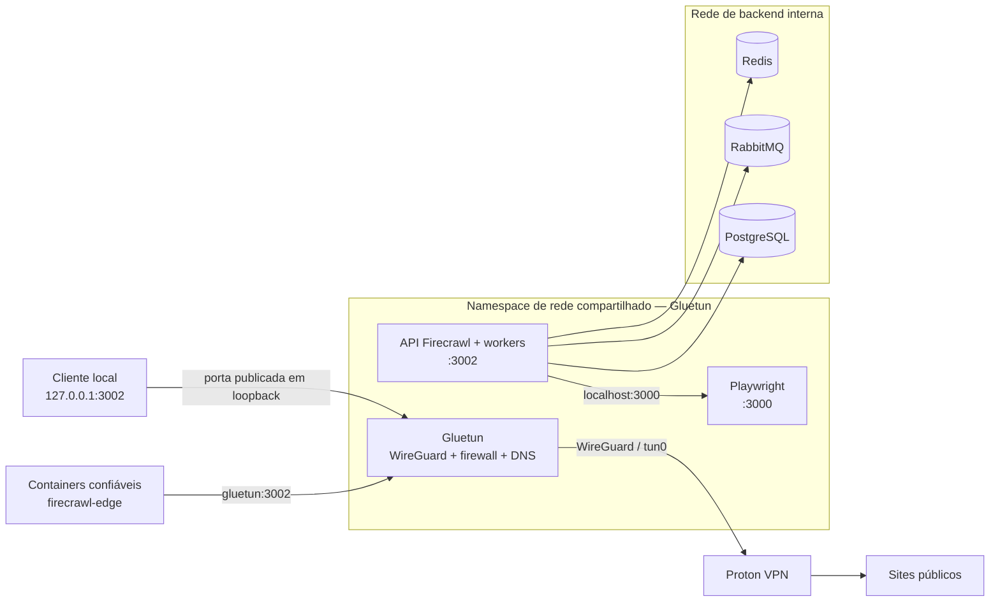

<div align="center">

# 🛡️ Firecrawl sobre Proton VPN

**Firecrawl self-hosted com tráfego de saída roteado pela Proton VPN e isolamento de rede projetado para falhar de forma segura.**

[](https://github.com/beto-zip/web-scraping-firecrawl-vpn/actions/workflows/validate.yml)
[](LICENSE)


[English](README.md) · **Português (Brasil)**

[Visão geral](#visão-geral) · [Arquitetura](#arquitetura) · [Início rápido](#início-rápido) · [Segurança](#segurança-e-limitações) · [Status](#status-do-projeto) · [Documentação](#documentação) · [Apoio](#apoie-o-projeto-planejado)

</div>

> [!IMPORTANT]
> **A validação da implantação ainda está pendente.** O código e os testes existem, mas a stack completa **ainda não foi verificada no servidor Linux com Tailscale/OpenClaw de destino** ([issue #6](https://github.com/beto-zip/web-scraping-firecrawl-vpn/issues/6)). Não trate o kill switch ou a proteção contra vazamentos como comprovados em produção antes de executar os testes de rede no seu servidor.
>
> **Projeto comunitário independente.** Sem afiliação oficial com Firecrawl, Proton VPN ou Gluetun.

## Visão geral

Configurar um proxy HTTP não garante que todos os scrapers, navegadores, consultas DNS e clientes internos o utilizem. Este projeto executa a API/workers do Firecrawl e o Playwright no **namespace de rede compartilhado do Gluetun**. O Gluetun fornece o túnel WireGuard da Proton VPN e o firewall; os serviços de scraping não possuem interfaces Docker externas independentes.

| Recurso | Implementação |
|:--|:--|
| 🛡️ Saída pela VPN | Firecrawl e Playwright utilizam `network_mode: service:gluetun`. |
| 🚫 Projeto fail-closed | O firewall do Gluetun foi configurado para negar a saída direta se o túnel cair; **a validação no servidor real ainda está pendente**. |
| 🌍 Seleção de saída | Configure país/cidade da Proton e solicite reconexão com `scripts/rotate-ip.sh`. **Não há garantia** de IP diferente. |
| 🔒 Backend isolado | Redis, RabbitMQ e PostgreSQL usam uma rede Docker com `internal: true`. |
| 🔌 Integração local | API local em `127.0.0.1:3002` e acesso por containers *confiáveis* via `firecrawl-edge`. |
| 🧪 Verificações | Scripts cobrem configuração, saída VPN, kill switch, rotação e recuperação. O CI não testa uma VPN real. |

## Arquitetura



**Ponto essencial:** a API e o navegador compartilham a rede do Gluetun, enquanto os bancos de dados ficam em uma rede interna separada. Isso representa o **projeto da arquitetura**, não uma comprovação de eliminação de todos os riscos e vazamentos. Detalhes: [arquitetura](docs/architecture.md) e [modelo de segurança](docs/security.md).

## Início rápido

### Requisitos

- Linux com Docker Engine, Docker Compose v2 e `/dev/net/tun`.
- **Plano pago da Proton VPN** e uma configuração WireGuard gerada. Consulte o [guia Proton VPN](docs/protonvpn.md).
- `curl` para os testes e `openssl` para gerar senhas fortes.
- Memória suficiente para o navegador. O consumo ocioso documentado é de aproximadamente 2,5 GB; o uso real varia com a carga.

### Instalação

```bash
git clone https://github.com/beto-zip/web-scraping-firecrawl-vpn.git
cd web-scraping-firecrawl-vpn
cp .env.example .env

# Edite o .env: insira a PrivateKey do WireGuard e configure
# as senhas e a chave da API de controle exigidas.
# Gere cada segredo separadamente: openssl rand -hex 24
# NUNCA versione o .env nem o arquivo .conf da Proton.

./scripts/validate.sh
docker compose up -d
docker compose ps
```

Mantenha `API_BIND_ADDRESS=127.0.0.1` no `.env`. **A API do Firecrawl não tem autenticação geral habilitada**; não exponha a porta 3002 à internet pública.

### Faça uma requisição

```bash
curl -sS -X POST http://127.0.0.1:3002/v2/scrape \
  -H 'Content-Type: application/json' \
  -d '{"url":"https://example.com","formats":["markdown"]}'
```

Um aplicativo confiável conectado à `firecrawl-edge` pode usar `http://gluetun:3002`. Veja o [exemplo de cliente](examples/client/README.md).

Para detalhes do sistema, variáveis de ambiente, atualizações e remoção, use o [guia completo de instalação](docs/installation.md).

## Segurança e limitações

A stack está configurada para limitar a saída à internet, mas **não passou por uma auditoria de segurança completa**.

- **Kill switch:** as regras de firewall foram projetadas para bloquear a saída direta sem VPN; valide esse comportamento no servidor.
- **DNS e IPv6:** o DNS é gerenciado pelo Gluetun (DNS over TLS); as redes Docker são apenas IPv4.
- **Destinos privados:** regras adicionais restringem conexões para host/LAN/Tailscale e metadados de nuvem, exceto a sub-rede de backend necessária.
- **Acesso à API:** containers autorizados na `firecrawl-edge` podem alcançar outras portas do namespace compartilhado. Não conecte containers não confiáveis.
- **Reinícios:** reconectar o túnel é diferente de reiniciar o container Gluetun. Após reiniciar o Gluetun, execute `docker compose restart api playwright`; caso ele seja *recriado*, use `docker compose up -d`.
- **Rotação de IP:** a reconexão pode reutilizar o IP de saída e interromper requisições em andamento.

### Valide seu ambiente

```bash
# Todos os testes, exceto a suíte de recuperação:
./scripts/run-tests.sh --skip-recovery

# Suíte completa (também reinicia containers):
./scripts/run-tests.sh
```

> [!WARNING]
> **Ambos os comandos podem interromper conexões de scraping**, inclusive com `--skip-recovery`. Execute em uma janela de manutenção. Os relatórios ficam em `reports/`, com segredos/IPs mascarados; revise antes de compartilhar. O CI não substitui testes com VPN real.

Consulte: [controles de segurança e riscos residuais](docs/security.md) · [limitações conhecidas](docs/architecture.md#known-limitations) · [solução de problemas](docs/troubleshooting.md).

## Status do projeto

| Frente | Situação |
|:--|:--|
| Stack Docker, validação de configuração, namespace VPN e scripts de teste | Implementados no repositório; verificação em servidor real pendente |
| Implantação Linux com Tailscale e OpenClaw | [Issue #6 aberta](https://github.com/beto-zip/web-scraping-firecrawl-vpn/issues/6) |
| Operação simplificada só com Docker | [Planejado #2](https://github.com/beto-zip/web-scraping-firecrawl-vpn/issues/2) |
| Resiliência, tentativas e detecção de bloqueios | [Planejado #3](https://github.com/beto-zip/web-scraping-firecrawl-vpn/issues/3) |
| Fila persistente e retomada de trabalhos | [Planejado #4](https://github.com/beto-zip/web-scraping-firecrawl-vpn/issues/4) |
| Doações voluntárias | [Backlog #10](https://github.com/beto-zip/web-scraping-firecrawl-vpn/issues/10); não habilitadas |

Acompanhe as [issues do GitHub](https://github.com/beto-zip/web-scraping-firecrawl-vpn/issues). Funcionalidades planejadas **ainda não estão presentes** na versão atual.

## Documentação

| Guia | Conteúdo |
|:--|:--|
| [Instalação](docs/installation.md) | Setup, atualizações e remoção |
| [Proton VPN](docs/protonvpn.md) | Chave WireGuard, região de saída e rotação |
| [Arquitetura](docs/architecture.md) | Isolamento de rede, componentes e ADRs |
| [Segurança](docs/security.md) | Modelo de ameaças, proteções e riscos residuais |
| [Solução de problemas](docs/troubleshooting.md) | Diagnóstico e recuperação |
| [Exemplo de cliente](examples/client/README.md) | Integração com outros containers Docker |

## Como contribuir

Use os [templates de issues](.github/ISSUE_TEMPLATE) para relatar bugs e resultados reproduzíveis. Pull requests objetivos e correções de documentação são bem-vindos. **Nunca publique** `.env`, chaves privadas WireGuard, IPs sem mascaramento ou logs sensíveis. Respeite os termos do provedor de VPN, os termos dos sites e o `robots.txt`. O projeto não implementa resolução automática de CAPTCHA.

## Licença

Os arquivos próprios deste repositório estão sob a licença [MIT](LICENSE). As imagens de terceiros mantêm suas próprias licenças (incluindo AGPL-3.0 do Firecrawl); a licença MIT deste repositório não substitui essas obrigações.

## Apoie o projeto (planejado)

O projeto é gratuito e de código aberto. Existe um **protótipo de página de doações apenas com criptomoedas** (Bitcoin, Monero e Ethereum), mas **as doações não estão habilitadas**. O endereço público Bitcoin já foi adicionado ao protótipo; Monero e Ethereum continuam sem configuração.

- [Veja o código da página de doações](docs/donate/index.html) e as [instruções/status](docs/donate/README.md).
- **A publicação no GitHub Pages não foi confirmada.** Por enquanto, não anunciamos um link como página de arrecadação ativa.
- A arrecadação só será considerada após a [validação do servidor #6](https://github.com/beto-zip/web-scraping-firecrawl-vpn/issues/6) e os [requisitos de release e financiamento da issue #10](https://github.com/beto-zip/web-scraping-firecrawl-vpn/issues/10).

Qualquer contribuição futura será **voluntária**, sem garantia de suporte, prioridade de funcionalidades, acesso especial ou segurança.
