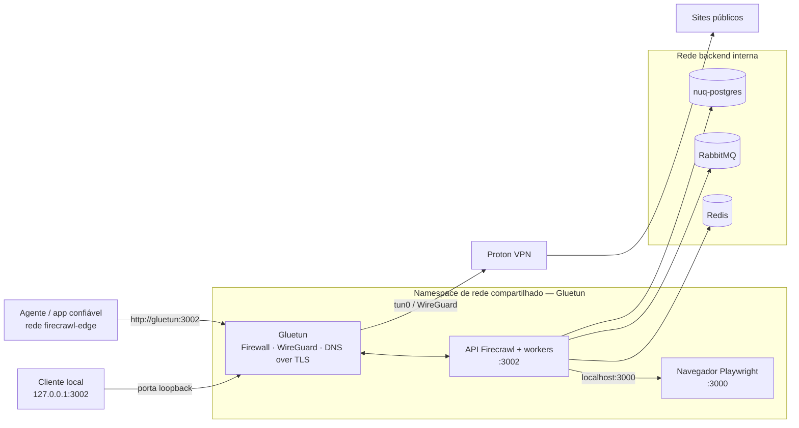

<div align="center">

# 🛡️ Firecrawl sobre Proton VPN

**Web scraping self-hosted com tráfego de saída pela VPN e isolamento de rede fail-closed.**

[](https://github.com/beto-zip/web-scraping-firecrawl-vpn/actions/workflows/validate.yml)
[](LICENSE)


[English](README.md) · **Português (Brasil)**

[Por quê?](#por-que-este-projeto) · [Arquitetura](#arquitetura) · [Instalação](#início-rápido) · [Segurança](#limites-de-segurança) · [Roadmap](#status-do-projeto-e-roadmap)

</div>

> [!IMPORTANT]
> **Projeto comunitário e integração não oficial.** Sem afiliação com [Firecrawl](https://github.com/firecrawl/firecrawl), [Proton VPN](https://protonvpn.com/) ou [Gluetun](https://github.com/qdm12/gluetun). A stack **ainda não foi validada no servidor Linux de destino** ([issue #6](https://github.com/beto-zip/web-scraping-firecrawl-vpn/issues/6)); execute os testes de rede antes de confiar nela para cargas sensíveis.

## Por que este projeto?

Ferramentas de scraping podem expor acidentalmente o IP do servidor quando apenas parte das requisições usa proxy. Este projeto adota outra abordagem: **a API do Firecrawl e o Playwright compartilham o namespace de rede do Gluetun**, submetendo o tráfego ao mesmo firewall e túnel WireGuard da Proton VPN.

| Recurso | Funcionamento |
|:--|:--|
| 🛡️ **Saída fail-closed** | O firewall bloqueia acesso direto à internet quando o túnel VPN fica indisponível. |
| 🌍 **Local de saída selecionável** | Configure país/cidade no `.env`; solicite outro IP com `scripts/rotate-ip.sh`. |
| 🧩 **Firecrawl self-hosted** | API scrape/crawl, workers e navegador Playwright em Docker Compose. |
| 🔒 **Backend isolado** | Redis, RabbitMQ e PostgreSQL permanecem numa rede Docker interna. |
| 🔌 **Integração com agentes** | API local em `127.0.0.1:3002` ou containers confiáveis em `firecrawl-edge`. |
| 🧪 **Testes de rede** | Scripts verificam IP de saída, kill switch, rotação e recuperação dos serviços. |

## Arquitetura



**O ponto principal:** `api` e `playwright` usam `network_mode: service:gluetun`. Eles **não** possuem interfaces Docker independentes para saída. O firewall do Gluetun controla o túnel; a rede `backend` possui `internal: true`, e a rede `edge` atende consumidores confiáveis da API.

Detalhes da implementação e decisões: [Arquitetura](docs/architecture.md) e [Segurança](docs/security.md).

## Início rápido

### Pré-requisitos

- Servidor Linux com Docker Engine, Docker Compose v2 e `/dev/net/tun`.
- **Plano pago da Proton VPN** com configuração WireGuard gerada; veja o [guia Proton](docs/protonvpn.md).
- `curl` para os testes, `openssl` para gerar segredos (`jq` é opcional).
- Memória suficiente para navegadores; consulte os [requisitos de instalação](docs/installation.md).

### Instale e inicie

```bash
git clone https://github.com/beto-zip/web-scraping-firecrawl-vpn.git
cd web-scraping-firecrawl-vpn

cp .env.example .env
# Insira a PrivateKey do WireGuard e gere as senhas necessárias:
# openssl rand -hex 24
# Nunca versione .env nem o arquivo .conf baixado da Proton.

./scripts/validate.sh
docker compose up -d
docker compose ps
```

Mantenha `API_BIND_ADDRESS=127.0.0.1` a menos que você implemente uma camada própria de acesso autenticado: **a API self-hosted não tem autenticação geral habilitada**.

### Faça uma requisição

```bash
curl -sS -X POST http://127.0.0.1:3002/v2/scrape \
  -H 'Content-Type: application/json' \
  -d '{"url":"https://example.com","formats":["markdown"]}'
```

Um container confiável conectado à `firecrawl-edge` pode usar `http://gluetun:3002`. Consulte o [exemplo de integração](examples/client/README.md).

**Guias completos:** [Instalação](docs/installation.md) · [Chave WireGuard e países](docs/protonvpn.md) · [Solução de problemas](docs/troubleshooting.md). A documentação técnica está em inglês.

## Limites de segurança

A segurança proposta se apoia em **isolamento de rede, não em uma configuração de proxy**:

1. **Túnel indisponível → scraping sem saída direta.** O firewall do Gluetun foi configurado para negar o acesso externo fora do túnel.
2. **Sem rota IPv6 de saída.** As redes Docker usam apenas IPv4; o Gluetun gerencia DNS sobre TLS.
3. **Destinos privados restritos.** Regras adicionais bloqueiam novas conexões para redes locais, Tailscale/CGNAT e metadados de nuvem, com exceção da sub-rede de backend necessária.
4. **Serviços sem acesso a sockets raw.** Firecrawl e Playwright descartam as capabilities do Linux.
5. **Roteamento do host independente.** Alterações de rede ficam no namespace Docker; a **convivência com Tailscale ainda precisa de validação no servidor real** ([#6](https://github.com/beto-zip/web-scraping-firecrawl-vpn/issues/6)).

> [!WARNING]
> **Não** exponha a porta 3002 publicamente nem conecte containers não confiáveis à `firecrawl-edge`. A API não dispõe de autenticação geral e os membros da rede edge podem acessar outras portas do namespace. Isso não substitui uma auditoria de segurança.

### Valide no seu servidor

```bash
./scripts/run-tests.sh --skip-recovery
# Suíte completa (inclui reinicialização de containers):
./scripts/run-tests.sh
```

Os testes cobrem `validate.sh`, scraping, saída VPN, kill switch, rotação e recuperação. **Mesmo com `--skip-recovery`, os testes interrompem temporariamente a rede**; execute em janela de manutenção. Relatórios são gravados em `reports/`, com IPs e segredos mascarados. O CI verifica código/configurações sem credenciais reais da Proton; CI não prova ausência de vazamentos em produção.

Para tentar trocar o IP da VPN sem reiniciar o namespace:

```bash
./scripts/rotate-ip.sh
```

A reconexão pode manter o mesmo IP; requisições em andamento podem falhar. Após um **reinício do container Gluetun** (diferente de reconectar o túnel), use `docker compose restart api playwright`. Veja as [limitações conhecidas](docs/architecture.md#known-limitations).

## Status do projeto e roadmap

| Etapa | Escopo | Situação |
|:--|:--|:--|
| Base | Stack Docker, namespace VPN, firewall, testes e rotação manual de IP | **Implementada no repositório; validação do deploy pendente** |
| Validação no servidor | Testes no Linux com Tailscale e cliente OpenClaw | [Issue #6 aberta](https://github.com/beto-zip/web-scraping-firecrawl-vpn/issues/6) |
| Operação simplificada | Executar ferramentas inteiramente via Docker | [Planejado #2](https://github.com/beto-zip/web-scraping-firecrawl-vpn/issues/2) |
| Resiliência | Detecção de bloqueios, políticas de retry e fluxo anti-bloqueio | [Planejado #3](https://github.com/beto-zip/web-scraping-firecrawl-vpn/issues/3) |
| Orquestração | Fila persistente de URLs com retomada | [Planejado #4](https://github.com/beto-zip/web-scraping-firecrawl-vpn/issues/4) |
| Apoio comunitário | Avaliar doações/patrocínios voluntários **após** validação e release pública estável | **Etapa futura — sem links de pagamento** |

Acompanhe o trabalho nas [issues do GitHub](https://github.com/beto-zip/web-scraping-firecrawl-vpn/issues). Funcionalidades futuras **não** estão disponíveis na stack atual.

## Documentação e contribuições

| Guia | Conteúdo |
|:--|:--|
| [Arquitetura](docs/architecture.md) | Fluxos, namespace, decisões e limitações |
| [Instalação](docs/installation.md) | Deploy, atualizações e remoção |
| [Proton VPN](docs/protonvpn.md) | Chave WireGuard, locais de saída e rotação |
| [Segurança](docs/security.md) | Modelo de ameaças, proteções e riscos residuais |
| [Solução de problemas](docs/troubleshooting.md) | Recuperação e falhas comuns |
| [Exemplo de cliente](examples/client/README.md) | Integração de outra aplicação Docker |

Relatos de bugs, testes reproduzíveis e pull requests objetivos são bem-vindos. Utilize os [templates de issues](https://github.com/beto-zip/web-scraping-firecrawl-vpn/issues/new/choose). Não publique segredos, IPs completos ou logs sensíveis. Respeite os termos da Proton e as regras/robots dos sites acessados. Resolução automática de CAPTCHA **não** está implementada.

## Licença

Os arquivos próprios deste repositório usam a licença [MIT](LICENSE). A stack executa imagens de terceiros sob suas respectivas licenças (incluindo AGPL-3.0 do Firecrawl), que continuam aplicáveis. Este repositório não redistribui o código-fonte desses projetos.
